# Volume 1 — Project Overview & Architecture

**PayLesShopMore Software Developer Handbook**
Checked against branch `main` of `paylesshopmore/paylesshopmore.com` on
**2026-11-05**. Files cited were read on that date; if they have changed since,
re-check the sections that cite them (list at the end of this volume).

---

## Table of contents

1. [What the application does](#1-what-the-application-does)
2. [The system at a glance](#2-the-system-at-a-glance)
3. [Technology stack](#3-technology-stack)
4. [Repository and folder structure](#4-repository-and-folder-structure)
5. [Frontend architecture](#5-frontend-architecture)
6. [Backend architecture](#6-backend-architecture)
7. [Database architecture (overview)](#7-database-architecture-overview)
8. [API architecture](#8-api-architecture)
9. [How React communicates with Django](#9-how-react-communicates-with-django)
10. [The request lifecycle, end to end](#10-the-request-lifecycle-end-to-end)
11. [How data moves through the system](#11-how-data-moves-through-the-system)
12. [How the application handles errors](#12-how-the-application-handles-errors)
13. [How the application handles user sessions](#13-how-the-application-handles-user-sessions)
14. [How the major components depend on each other](#14-how-the-major-components-depend-on-each-other)
15. [Production topology (summary)](#15-production-topology-summary)
16. [Architecture risks and open questions](#16-architecture-risks-and-open-questions)
17. [Glossary (part 1)](#17-glossary-part-1)
18. [Source files this volume depends on](#18-source-files-this-volume-depends-on)

---

## 1. What the application does

PayLesShopMore is a **shop-and-ship logistics service** between the
Netherlands and the Dutch Caribbean. Customers on Aruba, Bonaire and Curaçao
buy from Dutch/European webshops (Bol.com, Coolblue, IKEA, Zalando, …), have
the parcels delivered to the company's warehouse in the Netherlands, and the
company consolidates, measures, packs and ships them by **sea or air** to the
island, where they are delivered or collected.

The web application (`paylesshopmore.com`) runs every part of that business:

| Area | Who uses it | What it does | Where (frontend) |
|---|---|---|---|
| Public website | Anyone | Marketing pages, destinations, shipping calculator, FAQ, blog, contact form, quote requests, booking form, track & trace | `/`, `/booking`, `/calculator`, `/blog`, … |
| Customer account | Signed-in customers | Profile, addresses, shipments and their timeline, bookings, invoices, uploaded documents, pre-alerts, two-factor | `/profile`, `/prealert` |
| Office dashboard | Office staff and admins | Quotes, messages, packages, bookings, invoices (editor + PDF), customers, workers, shops, blog, courier tracking, pre-alerts, AI document review, reports, security, system status | `/dashboard/*` |
| Warehouse floor | Warehouse workers, warehouse manager, office | Scanning, intake sheets, measuring (incl. camera), packaging, damage reports, photos, shipping labels | `/warehouse/*` |
| Driver | Drivers on the island | Deliveries list, proof of delivery | `/driver` |
| Other software | Integrations (API keys) | Machine-to-machine API and outgoing webhooks | `/api/integrations/v1/` |

[VERIFIED: `frontend/src/App.jsx`, `docs/WEBSITE-MAP.md`, `backend/config/urls.py`]

### 1.1 The people (roles)

Roles are a field on the custom user model, `accounts.User.role`
(`backend/accounts/models.py`). Each role sets two permission flags,
`is_staff` (office) and `is_warehouse` (floor), from a fixed table
`ROLE_FLAGS`, so the flags cannot drift from the role:

| Role (`role` value) | Label | `is_staff` | `is_warehouse` | Gets into |
|---|---|---|---|---|
| `customer` | Customer | ✗ | ✗ | Public site, `/profile` |
| `admin` | Admin | ✓ | ✗ | Everything, incl. role changes, security, system |
| `office` | Office worker | ✓ | ✓ | Dashboard and warehouse, not admin-only actions |
| `warehouse` | Warehouse worker | ✗ | ✓ | Warehouse floor only |
| `manager` | Warehouse manager | ✗ | ✓ | Warehouse + manages workers, PINs, floor devices |
| `driver` | Driver | ✗ | ✗ | `/driver` only |

[VERIFIED: `accounts/models.py` lines 86–118, `staff/permissions.py`]

Note that an **admin** has `is_staff=True, is_warehouse=False` in the table but
still reaches the warehouse, because the warehouse checks
`is_staff or is_warehouse` (`User` property at `accounts/models.py:193`). Full
detail → Vol 6 §11.

### 1.2 The life of a shipment

The central business object is the **Package** (`accounts.models.Package`, a
shipment belonging to a customer). It has **two** independent progress
fields — one for the customer-facing commercial status, one for the floor:

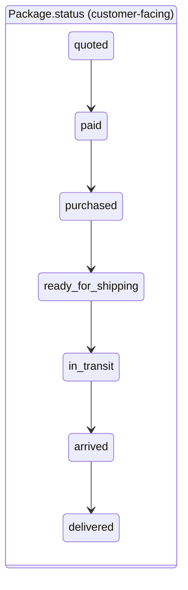

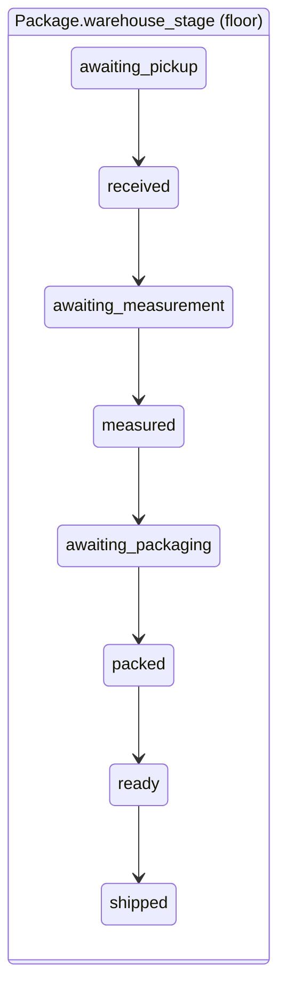

A ninth status, `cancelled`, exists alongside these.
[VERIFIED: `Package.Status` and `Package.WarehouseStage` in
`accounts/models.py` ~lines 509–640.] The diagrams show the *intended order*
described in the model's comments; exactly which jumps are allowed (and which
raise `InvalidShipmentTransition`) is documented per transition in → Vol 4 §2.

Two rules sit directly on the model, so every write path obeys them (API,
admin, shell, management commands):

- **Shipment lock** — once a shipment has progressed far enough, changes are
  refused with `ShipmentLocked`. The API turns that into **HTTP 409**, not 500
  (`accounts/errors.py`, §12.2).
- **Stage time limits** — `WAREHOUSE_STAGE_LIMITS` says how long a package may
  sit in each floor stage (e.g. 1 day in `received`, 5 days in `ready`) before
  the warehouse board flags it as waiting too long.

A typical end-to-end journey:

```mermaid
flowchart LR
    A[Customer fills in<br/>booking form /booking] --> B[Booking + BookingOrders<br/>bookings app]
    B --> C[Customer may pre-alert<br/>courier numbers /prealert]
    C --> D[Courier tracking follows<br/>parcel to NL warehouse<br/>tracking app + 17TRACK]
    D --> E[Warehouse intake:<br/>scan, intake sheet,<br/>measure, photos<br/>warehouse app]
    E --> F[Packed, label printed,<br/>ready for shipping]
    F --> G[Office issues invoice<br/>PDF + e-mail<br/>invoicing + notifications]
    G --> H[Sea / air freight<br/>in_transit]
    H --> I[Arrived on island]
    I --> J[Driver delivers,<br/>proof of delivery<br/>accounts.driver]
```

Each box is a separate Django app; §6.2 maps them.

---

## 2. The system at a glance

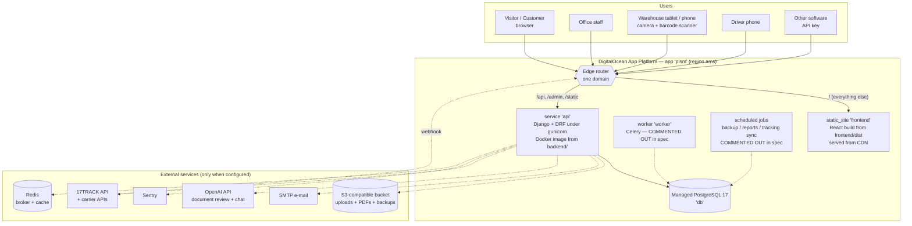

[VERIFIED: `.do/app.yaml`, `backend/requirements*.txt`,
`backend/config/settings.py`]. Dotted lines are optional: each external
service is **inert unless its environment variable is set** (see §3.3).
Whether each one is switched on in production is **[UNVERIFIED]** — that lives
in the DigitalOcean dashboard, not in git (§16).

The single most important architectural decision is in the router box:
**the browser only ever sees one origin.** `/api/*`, `/admin/*` and
`/static/*` go to Django; everything else goes to the React static files.
That keeps the session cookie *first-party*, which is what keeps customers
signed in on Safari and Firefox. §9 explains why in detail.

---

## 3. Technology stack

### 3.1 Frontend

| Technology | Version (from `frontend/package.json`) | Role in this project |
|---|---|---|
| Node.js | `22.x` (`engines`, `.nvmrc`) | Build tooling only; nothing Node runs in production |
| React | `^19.2.8` | UI library |
| React DOM | `^19.2.8` | Renders into `<div id="root">` |
| React Router DOM | `^7.18.3` | Client-side routing (`BrowserRouter`, `<Routes>`) |
| Vite | `^8.2.2` | Dev server (port 5173) with `/api` proxy, production bundler |
| `@vitejs/plugin-react` | `^6.1.0` | JSX transform, fast refresh |
| Bootstrap | `5.3.8` | Used **scoped** for the invoice pages only (via Sass) |
| Sass | `1.97.3` | Compiles `pages/Dashboard/invoice/invoice.scss` |
| CSS Modules | (built into Vite) | Default styling: `Component.module.css` next to each component |
| tesseract.js | `7.0.0` + `@tesseract.js-data/eng`, `/nld` | In-browser OCR of shipping labels (`src/ocr/`) |
| `@zxing/browser`, `@zxing/library` | `^0.1.5`, `^0.21.3` | Barcode / QR scanning from the camera |
| Vitest | `^5.0.3` | Test runner (configured inside `vite.config.js`) |
| Testing Library | React `^16.3.3`, user-event `^14.6.7`, jest-dom `^7.0.1` | Component tests |
| jsdom | `^30.0.1` | Browser environment for tests |
| ESLint | `^10.9.0` + react-hooks, react-refresh plugins | Linting (`npm run lint`) |
| sharp | `^0.35.5` | Image optimisation scripts (`npm run images`, `npm run logos`) |

**Language:** plain **JavaScript (ES modules, JSX)**. There is no TypeScript
in `src/`. `@types/react` is installed only for editor hints. → Vol 2 §0
discusses whether and how to migrate.

**Not used:** Axios, Redux/Zustand/React Query, Tailwind, Next.js. The
project uses a hand-written `fetch` wrapper (§9.3) and React Context (§5.4).
[NOT IMPLEMENTED — documented as absent, by design.]

### 3.2 Backend

| Technology | Version (from `backend/requirements*.txt`) | Role |
|---|---|---|
| Python | 3.12 (`FROM python:3.12-slim`, CI `setup-python 3.12`) | Runtime |
| Django | `5.2.17` | Web framework, ORM, admin, sessions |
| Django REST Framework | `3.18.0` | JSON API: views, serializers, permissions, throttling |
| django-cors-headers | `4.9.0` | CORS (mostly dormant: same-origin deployment) |
| argon2-cffi | `25.1.0` | Argon2id password hashing |
| cryptography | `50.0.2` | Encrypts two-factor secrets at rest |
| Celery | `5.6.3` | Background tasks — runs **inline** when no broker is set |
| ReportLab | `5.0.1` | Invoice PDF rendering |
| WhiteNoise | `6.11.0` | Serves the admin's static files from gunicorn |
| openai | `3.37.0` | AI document reading and chat assistant |
| pypdf | `6.21.2` | PDF text layer, to double-check what the AI read |
| gunicorn | `23.0.0` *(prod)* | WSGI server |
| psycopg[binary] | `3.2.10` *(prod)* | PostgreSQL driver |
| redis | `5.2.1` *(prod)* | Celery broker + cache, when `REDIS_URL` set |
| sentry-sdk | `2.35.0` *(prod)* | Error reporting, when `SENTRY_DSN` set |
| django-storages + boto3 | `1.14.6`, `1.35.99` *(prod)* | S3-compatible file storage, when `AWS_STORAGE_BUCKET_NAME` set |
| ruff | (`requirements-dev.txt`, `ruff.toml`) | Linting |

`requirements.txt` is pure-Python-or-wheels so a fresh Windows clone installs
with no compiler; `requirements-prod.txt` adds what only production needs
(`gunicorn` does not run on Windows at all). [VERIFIED: comments in both
files.]

### 3.3 "Inert unless configured" — the feature switches

A recurring pattern in `config/settings.py`: optional infrastructure is
switched on purely by the presence of an environment variable. Nothing has to
be uncommented in code.

| Variable present | Switches on | If absent |
|---|---|---|
| `DATABASE_URL` (or `POSTGRES_DB`) | PostgreSQL | SQLite in dev; **refuses to start** with `DJANGO_DEBUG=0` |
| `REDIS_URL` | Redis cache | Database cache table (prod) / local memory (dev) |
| `CELERY_BROKER_URL` | Real background worker | Tasks run inline in the request (`CELERY_TASK_ALWAYS_EAGER`) |
| `AWS_STORAGE_BUCKET_NAME` | S3-compatible media storage | Local disk `backend/media/` — **ephemeral on App Platform** |
| `SENTRY_DSN` | Sentry error reporting | Logs only |
| `OPENAI_API_KEY` | Document AI (`DOCUMENT_AI_AUTO`), chat assistant (`ASSISTANT_ENABLED`) | Both off |
| `SEVENTEEN_TRACK_API_KEY` | Live courier tracking | Tracking idle (mock provider available in DEBUG only) |
| `EMAIL_HOST` + `DJANGO_EMAIL_BACKEND` | Real e-mail | Backend default (see Vol 3 §25) |
| `BACKUP_DIR` / bucket | `manage.py backup_database` destination | Dev: `backend/backups/` |
| `DJANGO_TWO_FACTOR_ENCRYPTION_KEYS` | Encrypting 2FA secrets | → Vol 6 §7 |

[VERIFIED: `config/settings.py` lines 186–335, 882–1003, 1084–1240]

### 3.4 Infrastructure

| Piece | What | Source |
|---|---|---|
| Hosting | DigitalOcean App Platform, app `plsm`, region `ams` (Amsterdam) | `.do/app.yaml` |
| Frontend hosting | App Platform *static site* built with `npm run build`, output `dist`, `catchall_document: index.html` | `.do/app.yaml` |
| Backend hosting | App Platform *service* from `backend/Dockerfile`, 1 instance, `apps-s-1vcpu-1gb`, port 8000 | `.do/app.yaml` |
| Database | DigitalOcean managed PostgreSQL 17, `production: false` (dev tier) | `.do/app.yaml` |
| CI | GitHub Actions: `ci.yml` (Django, React, Origins), `smoke.yml` (live site, 06:20/18:20 UTC) | `.github/workflows/` |
| Dependency updates | Dependabot | `.github/dependabot.yml` |
| Local Docker | `backend/docker-compose.yml` | → Vol 8 §1 |

---

## 4. Repository and folder structure

### 4.1 Top level

```
pay-les-shop-more/
├── .do/
│   ├── app.yaml              DigitalOcean App Spec (committed, no secrets)
│   └── local/                REAL SECRETS — git-ignored, never commit
├── .github/
│   ├── workflows/ci.yml      Lint, checks, tests, build on every push
│   ├── workflows/smoke.yml   Probes the live site twice a day
│   └── dependabot.yml
├── .githooks/                Local git hooks (→ Vol 10)
├── backend/                  Django project (the API)
├── frontend/                 React app (the website)
├── docs/                     Topic guides + this handbook (docs/handbook/)
├── scripts/                  Repo-level Node scripts: check-origins.mjs, smoke.mjs
├── DEPLOYMENT.md
├── DIGITALOCEAN_DEPLOYMENT.md
└── node_modules/             Stray; NOT used by either app (see §16)
```

### 4.2 Backend (`backend/`)

```
backend/
├── manage.py                 Django's command-line entry point
├── config/                   The *project*: settings, root URLs, WSGI/ASGI, cross-cutting code
├── accounts/                 Users, roles, auth, packages, addresses, floor sign-in, 2FA, site settings
├── bookings/                 The public booking form ("boekingsbon")
├── enquiries/                Contact messages and quote requests (+ replies)
├── invoicing/                Invoices, lines, ports, charges, PDF rendering
├── notifications/            In-app notifications (the bell) + their e-mails
├── shops/                    Webshop list/logos shown on the site
├── blog/                     Blog posts
├── staff/                    The back-office API (/api/staff/) — views, no models of its own
├── warehouse/                Intake sheets, measurements, packaging, damage, photos, access
├── tracking/                 Courier tracking: carriers, shipments, events, adapters, 17TRACK
├── prealerts/                Customer pre-alerts of incoming parcels
├── integrations/             API keys (inbound) and webhooks (outbound)
├── docreview/                AI document reading with human review
├── assistant/                The website chat assistant (OpenAI)
├── ops/                      Backups, browser error reports, system status
├── Dockerfile, entrypoint.sh, docker-compose.yml
├── requirements.txt, requirements-prod.txt, requirements-dev.txt, ruff.toml
├── .env                      Local secrets — git-ignored
├── db.sqlite3                Local dev database — git-ignored
└── media/                    Local uploads — git-ignored
```

**Inside every app** the standard Django layout applies, extended with a few
project conventions:

| File | Holds | Convention in this project |
|---|---|---|
| `models.py` | Tables (ORM classes) | Business rules that *must* hold live here (e.g. shipment lock in `Package.save()`) |
| `serializers.py` | JSON ⇄ model conversion + validation | One serializer per audience (public / customer "My…" / staff) |
| `views.py` | Request handlers (DRF) | Public views state `permission_classes = [AllowAny]` explicitly |
| `urls.py` | URL patterns | Mounted under `/api/` by `config/urls.py` |
| `staff_urls.py`, `staff_views.py` | Office endpoints | Mounted under `/api/staff/...` |
| `tasks.py` | Celery tasks | Auto-discovered (`config/celery.py`) |
| `services.py`, other modules | Business logic used by several views | e.g. `notifications/services.py`, `warehouse/operations.py` |
| `management/commands/` | `manage.py <command>` scripts | Run by scheduled jobs |
| `test_*.py`, `tests.py` | Django tests | Many apps split tests per feature |
| `migrations/` | Schema history | Never edit an applied migration (→ Vol 4 §12) |

### 4.3 Frontend (`frontend/`)

```
frontend/
├── index.html                The HTML shell; loads src/main.jsx
├── vite.config.js            Build, dev proxy, prerender plugin, Vitest config
├── eslint.config.js
├── package.json / package-lock.json
├── public/                   Files copied as-is (favicons, robots, OCR data)
├── scripts/                  copy-ocr.js, prerender.js, routes.js, optimize-*.js, check-images.js
└── src/
    ├── main.jsx              ENTRY: providers + <App/>
    ├── App.jsx               THE ROUTE TABLE + app shell
    ├── api/                  Every call to Django (client.js + one file per area)
    ├── auth/                 AuthContext, useAuth, LanguageSync, home-page-for-role
    ├── i18n/                 nl / en / pap texts, LanguageContext, useLanguage
    ├── components/           Shared pieces (Header, Footer, guards, Tutorial, Chat…)
    ├── pages/                One folder per page or area (Dashboard/, Warehouse/, Profile/…)
    ├── hooks/                useShops, usePageMeta, useSpeech, useInViewport…
    ├── calculator/           Shipping price tables (rates.js) and maths (calculate.js)
    ├── measurement/          Camera measurement station
    ├── ocr/                  Label OCR (readLabel.js, labelFields.js)
    ├── labels/               Code128 barcode generation
    ├── data/                 Static data (destinations, shops, terms, company)
    ├── utils/                errorReporting, phone, volumeWeight, copyText, pageZoom
    ├── images/               Source images + optimized/ variants
    └── test/                 Test setup and shared helpers
```

Tests live **next to** the file they test (`Foo.jsx` + `Foo.test.jsx`).
→ Vol 2 has a component-by-component reference; The complete file reference (Part 13 of the brief) is in Vol 10.

---

## 5. Frontend architecture

### 5.1 Boot sequence

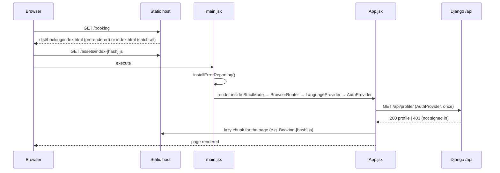

[VERIFIED: `src/main.jsx`, `src/auth/AuthContext.jsx`, `src/App.jsx`]

**Provider tree** (outermost first). Order matters: anything inside can use
anything outside.

```
<StrictMode>                       dev-only double render to surface bugs
  <BrowserRouter>                  URL state; required by every <Link>/<Routes>
    <LanguageProvider>             active language + t()
      <AuthProvider>               who is signed in (mirrors the server)
        <LanguageSync/>            tells the account which language the site is read in
        <App>
          <TutorialProvider>       guided tours
            <NotificationsProvider enabled={!isDashboard}>   the bell
              <ChatProvider>       website chat assistant
                <Header/> …
                <ErrorBoundary>    catches render crashes & failed chunk loads
                  <Suspense fallback={<Loading/>}>
                    <Routes> … </Routes>
                  </Suspense>
                </ErrorBoundary>
                <Footer/>, <ReauthDialog/>, <PageGuide/>, …
```

[VERIFIED: `src/main.jsx`; `src/App.jsx` lines ~190–407.] The exact position
of `Header`, `Footer`, `ReauthDialog` etc. inside `App.jsx` is covered in
→ Vol 2 §14.

### 5.2 The route table

`src/App.jsx` is the single source of truth for addresses. It declares about
70 `<Route>` entries in five areas:

| Area | Prefix | Guard component | Layout |
|---|---|---|---|
| Public | `/`, `/booking`, `/services`, `/tutorial`, `/contact`, `/privacy`, `/terms`, `/faq`, `/calculator`, `/blog`, `/blog/:slug`, `/destinations`, `/destinations/:slug` | none | Header + Footer |
| Auth pages | `/login`, `/signup`, `/two-factor`, `/forgot-password`, `/reset-password/:uid/:token` | `RedirectIfSignedIn` on login/signup | Header + Footer |
| Customer | `/profile`, `/prealert` | `RequireAuth` | Header + Footer |
| Office | `/dashboard`, `/dashboard/*` (≈25 children) | `RequireStaff` | `DashboardLayout` (sidebar) |
| Warehouse | `/warehouse`, `/warehouse/*`, `/warehouse/shipments/:id/label` | `RequireWarehouse` | `WarehouseLayout` |
| Driver | `/driver` | `RequireDriver` | — |
| Fallback | `*` | — | `NotFound` |

Old addresses are kept alive with `<Navigate … replace />` redirects (e.g.
`/tracking` → `/profile#tracking`, `/dashboard/intake` →
`/warehouse/intake`), so bookmarks and printed links keep working.

> **Guards are UX, not security.** The comment at the top of `App.jsx` says
> it plainly: guards "only change the screen — the backend refuses the data
> anyway." Every protected API view enforces its own permission (§6.4). Never
> rely on a guard to protect data.

Every page (except the shell) is loaded with `lazy(() => import(...))`, so
each page becomes its own JavaScript chunk, downloaded only when first
opened. → Vol 2 §25–26.

### 5.3 The API layer (`src/api/`)

**Pages never call `fetch` themselves.** They import functions from
`src/api/<area>.js`, which all build on `src/api/client.js`:

| File | Backend area |
|---|---|
| `client.js` | Base URL, cookies, CSRF, error mapping, re-auth, auth-failure broadcast |
| `auth.js`, `twoFactor.js` | `/api/auth/...` |
| `profile.js` | `/api/profile/`, addresses, packages, documents |
| `booking.js` | `/api/bookings/...` |
| `staff.js` (44 KB, the largest) | `/api/staff/...` |
| `warehouse.js` | warehouse endpoints under `/api/staff/` |
| `invoices.js`, `invoiceEditor.js`, `pricing.js` | invoicing |
| `tracking.js`, `prealerts.js` | tracking, pre-alerts |
| `contact.js`, `quote.js` | enquiries |
| `shops.js`, `blog.js`, `site.js`, `notifications.js`, `driver.js`, `assistant.js` | their apps |

This gives one place to change a URL, one place to handle errors, and lets
tests mock the network at a single seam.

### 5.4 State management

There is **no global store library**. State lives in three places:

1. **Server state** — owned by Django. The frontend re-reads it rather than
   caching it long-term (e.g. after signing in, `AuthContext` re-reads
   `/api/profile/` instead of trusting the login response).
2. **App-wide client state** — React Contexts:
   `AuthContext` (user), `LanguageContext` (language), `NotificationsProvider`,
   `TutorialProvider`, `ChatProvider`, and a warehouse `accessContext`.
3. **Page state** — `useState`/`useReducer` inside pages, plus a reusable
   `pages/Dashboard/useCollection.js` hook for paged/filtered lists.

Why this is reasonable here: the data is mostly per-page lists fetched on
demand, and the only truly global facts are "who am I" and "which language".
→ Vol 2 §28 discusses when that would stop being enough.

### 5.5 Internationalisation

All visible text comes from `src/i18n/` in **Dutch (`nl`), English (`en`) and
Papiamentu (`pap`)**. Pages call `t('booking.title')`. The website texts are
in `translations.js` (~440 KB), the dashboard in `dashboardTranslations.js`,
the warehouse flow in `warehouseFlowTranslations.js`, and per-page dashboard
texts in `i18n/pages/*.js`. `LanguageSync` writes the chosen language to the
user's account so that **e-mails** go out in the same language. → Vol 2 §i18n,
`docs/TRANSLATION_REVIEW.md`.

### 5.6 Styling

- **CSS Modules** by default: `Header.module.css` is imported as an object
  (`styles.nav`), so class names are locally scoped and cannot collide.
- `src/index.css` and `App.css` are the only global stylesheets.
- **Bootstrap 5** is compiled *scoped* for the invoice editor only
  (`pages/Dashboard/invoice/invoice.scss`), so it does not restyle the rest of
  the site.
- The dashboard has one large shared module, `Dashboard.module.css` (~108 KB)
  → candidate for splitting (Vol 2 §24).

### 5.7 SEO prerendering

`vite.config.js` adds a `prerender()` plugin (`scripts/prerender.js`,
`scripts/routes.js`) that writes a real HTML file per public route after the
build. The static host serves those files directly; any other path falls back
to `index.html` and React's router (`catchall_document: index.html` in
`.do/app.yaml`). → Vol 2 §SEO, Vol 8 §13.

### 5.8 Hardware-facing features (warehouse)

The warehouse UI uses the device camera in three ways, all in the browser:

| Feature | Code | Library |
|---|---|---|
| Barcode / QR scanning | `pages/Dashboard/Scan.jsx` | `@zxing/browser` |
| Shipping-label OCR | `src/ocr/readLabel.js`, `labelFields.js`; `pages/Dashboard/LabelReader.jsx` | `tesseract.js` (language data copied to `public/` by `scripts/copy-ocr.js` before `dev`/`build`) |
| Parcel measurement | `src/measurement/*`, `pages/Warehouse/camera/*` | Camera APIs + own maths (`docs/measurement-station.md`) |

Server-side, `warehouse/label_ai.py` can also read a label photo with AI
(throttle scope `label_read`). → Vol 2, Vol 3.

---

## 6. Backend architecture

### 6.1 Project vs. apps

Django separates the **project** (`config/`: settings, root URLs, WSGI) from
**apps** (feature folders). This project also puts *cross-cutting* code in
`config/`:

| `config/` file | Purpose |
|---|---|
| `settings.py` | All configuration, read from environment variables (58 KB, heavily commented) |
| `urls.py` | Root URL table (§8.1) |
| `wsgi.py` / `asgi.py` | Server entry points (gunicorn uses `config.wsgi:application`) |
| `celery.py` | Celery app; `config/__init__.py` imports it |
| `health.py` | `/api/health/` (liveness) and `/api/ready/` (readiness) |
| `client_ip.py` | Trusts a platform header for the real visitor IP |
| `request_limits.py` | Refuses oversized public uploads before reading the body |
| `security_headers.py` | Strict Content-Security-Policy on API JSON responses |
| `admin_access.py` | `/admin/` only from `DJANGO_ADMIN_ALLOWED_IPS` (when set) |
| `admin_login.py` | Throttled admin login |
| `abuse.py` | Site-wide hourly ceilings on anonymous "create" endpoints |
| `pagination.py` | `AdjustablePagination` (DRF default) |
| `checks.py` | Custom `manage.py check` rules (deployment safety) |
| `testing.py` | Test helpers |

### 6.2 The apps and what they own

| App | Main models | Exposes | Talks to |
|---|---|---|---|
| `accounts` | `User`, `Address`, `Package`, `PackageDocument`, `PackageEvent`, `DeliveryConfirmation`, floor sign-in (`WarehouseSignInCode`, `FloorDevice`, `FloorLocation`, `WarehousePin`, `FloorEvent`…), `SiteSettings`, two-factor (`TwoFactorPolicy`, `TwoFactorDevice`, …) | `/api/auth/…`, `/api/profile/…`, `/api/packages/`, `/api/addresses/`, driver deliveries | almost every app |
| `bookings` | `Booking`, `BookingOrder`, `BookingAttachment`, `BookingProduct`, `ShippingNumberSequence` | `/api/bookings/…` | `tracking`, `shops` |
| `enquiries` | `ContactMessage`, `ContactReply`, `QuoteRequest`, `QuoteReply` | contact + quote forms | e-mail |
| `invoicing` | `Invoice`, `InvoiceLine`, `InvoiceNumberSequence`, `InvoiceSettings`, `Port`, `ChargeType`, `InvoiceHistory` | `/api/invoices/` (customer), staff editor | `notifications`, PDF (`pdf.py`), Celery |
| `notifications` | `Notification` | `/api/notifications/` | e-mail via Celery |
| `shops` | `Shop` | `/api/shops/` | — |
| `blog` | `BlogPost` | `/api/blog/…` | — |
| `staff` | *(none)* | everything under `/api/staff/` | reads/writes other apps' models |
| `warehouse` | `IntakeSheet`, `Measurement`, `PackageMeasurement`, `PackagePackaging`, `PackageDamageReport`(+`Photo`), `PackagePhoto`, `IntakeSheetPhoto`, `PackageActivity`, `WarehouseAccess` | under `/api/staff/` | `accounts.Package` |
| `tracking` | `Carrier`, `CarrierShipment`, `TrackingEvent`, `TrackingSyncLog`, `TrackingNumberChange`, `CarrierIntegration` | `/api/tracking/…`, staff pages | 17TRACK + carrier adapters (`adapters/dhl.py`, `postnl.py`, …) |
| `prealerts` | `PreAlert`, `PreAlertDocument` | `/api/prealerts/`, `/api/staff/prealerts/` | `tracking` |
| `integrations` | `ApiKey`, `InboundEvent`, `WebhookEndpoint`, `WebhookDelivery` | `/api/integrations/v1/…` | outbound webhooks via Celery |
| `docreview` | `DocumentJob`, `DocumentJobAttempt`, `DocumentJobEvent` | `/api/staff/document-jobs/` | OpenAI, `pypdf` |
| `assistant` | *(none)* | one chat endpoint | OpenAI |
| `ops` | `BackupRun` | `/api/client-errors/`, system status | `pg_dump`, storage, Sentry |

[VERIFIED: class names from each `models.py`; routes from each `urls.py`.]
Field-level detail → Vol 4.

### 6.3 Inside an app: the layers of one request

```
URL pattern (urls.py)
   └─► View (views.py)              who may call it, which serializer, throttles
         ├─► Permission classes     IsAuthenticated / AllowAny / IsStaff / IsAdmin / …
         ├─► Throttles              per-IP / per-user / per-scope budget
         ├─► Serializer             parse + validate input; shape output
         ├─► Service / domain code  operations.py, services.py, sync.py …
         └─► Model / ORM            rules that must always hold (save(), constraints)
               └─► Database
```

The rule of thumb this codebase follows: **the lower the layer, the more
universal the rule.** Something that must hold for *every* write path (e.g.
the shipment lock) lives in the model; something that is only about one
endpoint (e.g. which fields a customer may send) lives in the serializer.

### 6.4 Defaults that make the API "closed by default"

From `REST_FRAMEWORK` in `config/settings.py` [VERIFIED]:

| Setting | Value | Consequence |
|---|---|---|
| `DEFAULT_AUTHENTICATION_CLASSES` | `SessionAuthentication` only | No JWT, no tokens for people. Integrations use their own API-key class. |
| `DEFAULT_PERMISSION_CLASSES` | `IsAuthenticated` | A view that forgets its permission is **locked**, not exposed. Public views must say `AllowAny`. |
| `DEFAULT_RENDERER_CLASSES` | JSON (+ browsable API only when `DEBUG`) | No self-documenting HTML API in production. |
| `DEFAULT_THROTTLE_CLASSES` | `AnonRateThrottle`, `UserRateThrottle` | anon `60/hour`, user `1000/hour`, plus ~20 named scopes |
| `DEFAULT_PAGINATION_CLASS` | `config.pagination.AdjustablePagination` | Lists are paged. |
| `EXCEPTION_HANDLER` | `accounts.errors.api_exception_handler` | Shipment-lock errors → 409 (§12.2). |

Named throttle scopes (all per hour): `login 10`, `code_login 240`,
`pin_login 300`, `two_factor 30`, `password_reset 5`, `forms 20`,
`tracking 40`, `assistant 60`, `prealerts 60`, `prealert_read 20`,
`label_read 300`, `client_errors 30`, `warehouse 6000`, `integration 3000`,
… → full table in Vol 6 §20.

Custom permission classes (`staff/permissions.py`): `IsStaff`, `IsAdmin`,
`IsWarehouseManager`, `IsStaffOrWarehouseManager`, plus warehouse access
checks in `warehouse/access.py` and `integrations/permissions.py`.

### 6.5 The middleware stack

Every request passes through this list **top to bottom**, the response
**bottom to top**. Order is deliberate; each custom entry's reason is in the
settings comments. [VERIFIED: `MIDDLEWARE` in `config/settings.py`]

| # | Middleware | Why it is here (and why at this position) |
|---|---|---|
| 1 | `config.client_ip.TrustedClientIPMiddleware` | First, so throttles and the admin allow-list see the real visitor IP (`Do-Connecting-Ip` in production) |
| 2 | `SecurityMiddleware` | HTTPS redirect, HSTS, nosniff |
| 3 | `whitenoise.middleware.WhiteNoiseMiddleware` | Serves `/static/` before any session/DB work. Only added if installed (`find_spec`). |
| 4 | `corsheaders.middleware.CorsMiddleware` | Above CommonMiddleware so it can answer preflights |
| 5 | `config.request_limits.PublicRequestSizeLimitMiddleware` | Rejects oversized public uploads before the body is read; below CORS so the refusal carries CORS headers |
| 6 | `SessionMiddleware` | Loads `request.session` from the cookie |
| 7 | `CommonMiddleware` | Trailing-slash handling etc. |
| 8 | `CsrfViewMiddleware` | CSRF token check on unsafe methods |
| 9 | `AuthenticationMiddleware` | Sets `request.user` from the session |
| 10 | `accounts.middleware.WarehouseIdleMiddleware` | Logs out an idle warehouse code session (needs `request.user`) |
| 11 | `accounts.middleware.TwoFactorMiddleware` | A session that still owes its 2FA code may only reach an allow-list of paths |
| 12 | `config.security_headers.ApiContentSecurityPolicyMiddleware` | Strict CSP on API JSON |
| 13 | `config.admin_access.AdminIpAllowListMiddleware` | `/admin/` only from allowed IPs, when configured |
| 14 | `MessageMiddleware` | Django admin flash messages |
| 15 | `XFrameOptionsMiddleware` | Clickjacking protection |

### 6.6 Background work (Celery) and the "eager" fallback

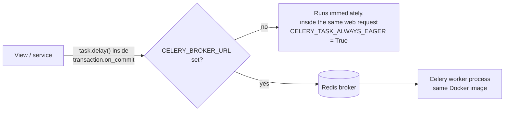

- `CELERY_TASK_ALWAYS_EAGER = not CELERY_BROKER_URL` — with no broker,
  `.delay()` runs the task synchronously. That is what production does today
  according to `.do/app.yaml` (the worker is commented out) **[UNVERIFIED in
  dashboard]**.
- `CELERY_TASK_EAGER_PROPAGATES = False` — a failing inline task does not turn
  the user's request into a 500.
- Task modules: `enquiries/tasks.py`, `invoicing/tasks.py` (e.g.
  `render_approved_invoice`), `notifications/tasks.py`
  (`send_notification_email`), `warehouse/tasks.py`, `integrations/tasks.py`
  (webhook delivery), `docreview/tasks.py`.
- Tasks are queued from `transaction.on_commit(...)` (e.g.
  `notifications/services.py::_queue_email`), so a task never runs for data
  that was rolled back.

> ⚠️ The spec warns: **do not set `CELERY_BROKER_URL` without running a
> worker** — tasks would be queued and never executed, silently.
> → Vol 3 §24, Vol 9.

Scheduled work is done by **management commands**, intended to be run by
App Platform scheduled jobs (all commented out in the spec — §16):

| Command | Intended schedule (UTC) | Purpose |
|---|---|---|
| `python manage.py backup_database` | `0 3 * * *` | Nightly `pg_dump` (`ops/backup.py`, `docs/BACKUPS.md`) |
| `python manage.py send_warehouse_report --yesterday` + `send_office_summary` | `0 6 * * *` | Daily reports |
| `python manage.py sync_carrier_tracking` | `15 */2 * * *` | Poll couriers (`tracking/sync.py`) |
| `python manage.py purge_login_activity` | `30 3 * * *` | Delete login records past `LOGIN_ACTIVITY_RETENTION_DAYS` (`loginactivity/`) |

### 6.7 External services the backend calls

| Service | Module | Triggered by |
|---|---|---|
| SMTP e-mail | Django mail; `accounts/emails.py`, `notifications/messages.py`, `enquiries/replies.py` | sign-up, reset, codes, notifications, replies |
| OpenAI | `docreview/ai.py`, `assistant/ai.py`, `warehouse/label_ai.py` | document jobs, chat, label reading |
| 17TRACK | `tracking/adapters/seventeen_track.py`, `tracking/providers.py`; webhook in `tracking/views.py` | sync command, webhook |
| Carrier APIs | `tracking/adapters/{dhl,postnl,dpd,fedex,amazon}.py` | per `CarrierIntegration` |
| Outbound webhooks | `integrations/webhooks.py`, `tasks.py` | domain events |
| S3-compatible storage | django-storages | every `FileField` when configured |
| Sentry | sentry-sdk | unhandled errors, browser reports |

---

## 7. Database architecture (overview)

### 7.1 Which database runs where

`config/settings.py` picks the database in this order [VERIFIED lines 186–335]:

1. `DATABASE_URL` set → **PostgreSQL** (parsed by `database_from_url`; only
   `postgres://`, `postgresql://`, `postgis://` accepted — anything else is an
   `ImproperlyConfigured` error, on purpose).
2. Else `POSTGRES_DB` set → PostgreSQL from separate `POSTGRES_*` variables
   (used by `docker-compose.yml`).
3. Else, **only if `DJANGO_DEBUG=1` or running tests** → SQLite file
   `backend/db.sqlite3`. With `DEBUG` off it **refuses to start** rather than
   serve an empty, disposable database.

| Environment | Database |
|---|---|
| Your PC (`runserver`) | SQLite `backend/db.sqlite3` |
| CI (`ci.yml`) | SQLite (no `POSTGRES_*` set) |
| Docker compose | PostgreSQL container |
| Production | DigitalOcean managed PostgreSQL 17 via `${db.DATABASE_URL}` |

Connection behaviour: `CONN_MAX_AGE=60` s (persistent connections; set `0`
behind a transaction pooler), `connect_timeout=10` s, `sslmode=require` for
non-private hosts when `DEBUG` is off.

> ⚠️ Tests run on SQLite while production runs PostgreSQL. Anything
> Postgres-specific (locking, case-insensitive constraints, JSON operators) is
> therefore **not** exercised by CI. → Vol 7 §risk.

### 7.2 Size and shape

About **63 concrete models** across 13 apps (counting tables, not helper
classes like `PackageQuerySet` or exception classes). `staff` and `assistant`
have none. Custom user: `AUTH_USER_MODEL = 'accounts.User'`, signing in by
**email** (unique, case-insensitive since migration
`accounts/0022_user_email_case_insensitive_unique`).

High-level entity map (details, every column, and full ER diagrams → Vol 4):

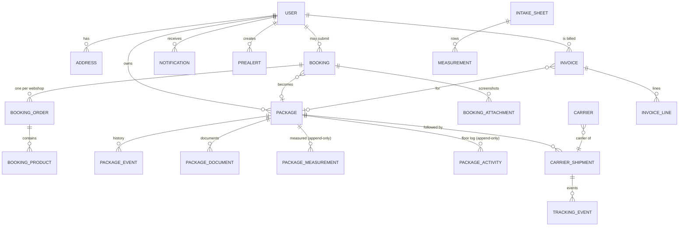

The relationship lines above are the **conceptual** map. Exact
cardinalities and nullability are verified field-by-field in → Vol 4; treat
this diagram as orientation only.

Notable patterns (each explained in Vol 4):

- **Append-only records** — `warehouse/models.py` defines `AppendOnlyModel` /
  `AppendOnlyQuerySet` / `ImmutableRecord`: measurements and floor activity
  are never edited in place, only added to, so history cannot be rewritten.
- **Number sequences in tables** — `CustomerNumberSequence`,
  `ShippingNumberSequence`, `InvoiceNumberSequence` give gap-controlled,
  human-readable numbers.
- **Data migrations** that seed or backfill (`blog/0002_seed_posts`,
  `tracking/0002_seed_carriers`, `invoicing/0006_seed_ports_and_charges`,
  `accounts/0008_backfill_package_events`,
  `accounts/0031_number_existing_customers`).
- **Cache table** `django_cache` — created by `createcachetable` at every
  start; holds throttle counters and lockouts when Redis is absent.

---

## 8. API architecture

### 8.1 URL namespace map

Root table: `backend/config/urls.py` [VERIFIED].

| Prefix | Included from | Audience | Auth |
|---|---|---|---|
| `/admin/` | Django admin (login wrapped in `throttled_admin_login`) | Admins | Session + optional IP allow-list |
| `/api/health/`, `/api/ready/` | `config/health.py` | Probes | Public |
| `/api/` | `accounts.urls` | Auth, profile, addresses, packages, driver, floor | Mixed |
| `/api/` | `enquiries.urls` | Contact, quote | Public (throttled) |
| `/api/` | `bookings.urls` | Booking form, "my bookings" | Public create; own data authenticated |
| `/api/` | `notifications.urls` | The bell | Authenticated |
| `/api/` | `invoicing.urls` | Customer invoices | Authenticated |
| `/api/` | `shops.urls`, `blog.urls` | Read-only public lists | Public |
| `/api/` | `prealerts.urls` | Customer pre-alerts | Authenticated |
| `/api/` | `ops.urls` | `/api/client-errors/` | Public (throttled 30/h) |
| `/api/` | `assistant.urls` | Chat | per view |
| `/api/staff/` | `staff.urls` | **Office back office** | `IsStaff` (and narrower) |
| `/api/staff/carrier-tracking/` | `tracking.staff_urls` | Office | staff |
| `/api/staff/tracking-integrations/` | `tracking.integration_urls` | Admins | admin |
| `/api/staff/prealerts/` | `prealerts.staff_urls` | Office | staff |
| `/api/integrations/v1/` | `integrations.urls` | Other software | **API key** |
| `/api/tracking/` | `tracking.urls` | Courier list, 17TRACK webhook | Public / signed |

Approximately **100 `path()` entries** plus about **30 DRF ViewSets**
registered on routers (`DefaultRouter`/`SimpleRouter` in `accounts`,
`invoicing`, `notifications`, `prealerts`, `staff`, `tracking`). A ViewSet
expands into several URL + method combinations, so the real number of
endpoints is several hundred. Every one is catalogued in → Vol 5.

### 8.2 Design rules visible across the API

1. **JSON in, JSON out.** Multipart only where files are uploaded (booking
   screenshots, documents, photos).
2. **One audience per endpoint.** The public booking view is `POST`-only and
   echoes back only `{id, created_at}` — "a bug in this view cannot leak
   somebody's shipment" (`bookings/views.py`). Customers read their own data
   through separate `mine/` endpoints; staff through `/api/staff/`.
3. **Closed by default** (§6.4).
4. **Domain refusals are 409**, validation is 400, identity is 403, rate
   limit is 429 (§12).
5. **Machine-readable `code`** in error bodies where the frontend must react
   (`reauth_required`, `two_factor_required`, `email_taken`).
6. **Trailing slashes** on every path (`/api/bookings/`), Django's convention.

---

## 9. How React communicates with Django

### 9.1 One origin, two programs

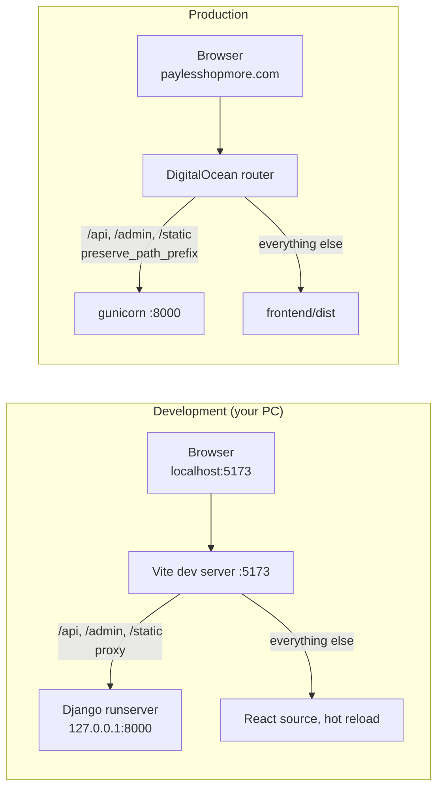

[VERIFIED: `vite.config.js` `server.proxy`; `.do/app.yaml` `routes`]

**Why it matters:** because the browser sees a single origin, the session and
CSRF cookies are *first-party*. Safari blocks and Firefox partitions
third-party cookies, so a separate `api.` domain would leave customers unable
to stay signed in. That is why:

- `client.js` uses the relative base `'/api'` by default.
- `SESSION_COOKIE_SAMESITE = CSRF_COOKIE_SAMESITE = 'Lax'` unless
  `DJANGO_CROSS_SITE_COOKIES=1`.
- `VITE_API_BASE_URL` exists only as a documented, worse escape hatch.
- CORS is configured but effectively dormant.
- `scripts/check-origins.mjs` runs in CI ("Origins" job) to keep the frontend,
  backend and spec in agreement.

> **`preserve_path_prefix: true` is load-bearing.** Without it, DigitalOcean
> strips `/api` and every request reaches Django as a 404. The classic
> symptom of a broken route is "the API answered with HTML" — React's
> `index.html` — and the app fails to parse it as JSON. `smoke.yml` exists to
> catch exactly this. → Vol 9.

### 9.2 Authentication on the wire

- **Session cookie** (`sessionid`): `HttpOnly`, `Secure` (prod), `SameSite=Lax`,
  set by Django on sign-in. JavaScript **cannot** read it — an XSS bug cannot
  steal it.
- **CSRF cookie** (`csrftoken`): readable by JavaScript on purpose
  (`CSRF_COOKIE_HTTPONLY = False`) because React must echo it back as the
  `X-CSRFToken` header on every write. It is not a credential.
- Every `fetch` uses `credentials: 'include'`.

### 9.3 `request()` in `src/api/client.js`, step by step

[VERIFIED: full file read]

```js
export async function request(path, options = {}) {
  const { method = 'GET', body, formData, silentAuthFailure = false,
          background = false, reauthDone = false } = options;
  const headers = {};
  if (background) headers['X-Background-Refresh'] = '1';     // (1)
  const isWrite = method !== 'GET' && method !== 'HEAD';
  if (isWrite) {
    const token = await csrfToken();                          // (2)
    if (token) headers['X-CSRFToken'] = token;
  }
  if (body !== undefined) headers['Content-Type'] = 'application/json'; // (3)
  // fetch(`${BASE_URL}${path}`, { method, headers, credentials: 'include', ... })
  ...
}
```

1. **Background flag** — timer-driven requests (board refresh, notification
   polling) send `X-Background-Refresh: 1` so the server does not count them
   as a warehouse worker being active (§13.3).
2. **CSRF** — read `csrftoken` from `document.cookie`; if a fresh tab has none,
   first call `GET /api/auth/csrf/` to get one.
3. **Content type** — JSON bodies set it; `FormData` uploads deliberately do
   **not**, because the browser must add the multipart boundary itself
   ("setting the header by hand is the classic way file uploads break").

Then the response is mapped to a typed `ApiError`:

| Server answer | `ApiError.code` | What the UI does |
|---|---|---|
| network failure (fetch rejects) | `UNAVAILABLE` | "Could not connect" + retry |
| `204` | — (returns `null`) | — |
| `2xx` | — (returns parsed JSON) | — |
| `401` | `INVALID_CREDENTIALS` | Login form message |
| `403` + `code: "reauth_required"` | — | Shows "Confirm it's you" dialog, **retries once**; cancel → `REAUTH_CANCELLED` |
| `403` (other) | `UNAUTHENTICATED` | Broadcast to `AuthContext` → re-checks profile → guard sends to login or out of the dashboard |
| `429` | `RATE_LIMITED` | "Too many attempts" |
| `400` + `code: "email_taken"` | `EMAIL_TAKEN` | Sign-up message |
| `400` | `VALIDATION` (`.fields` = per-field errors) | Inline field errors |
| anything else (409, 500, …) | `UNAVAILABLE` (body kept in `.fields`, status in `.status`) | Page decides, e.g. shows the 409 sentence |

> **Why 403 and not 401 for "not signed in"?** DRF's
> `SessionAuthentication` does not send a `WWW-Authenticate` header, so DRF
> answers unauthenticated requests with **403**. The frontend therefore
> treats 403 as "identity problem" and asks `AuthContext` to find out which
> one (no session vs. not allowed). → Vol 6 §2.

### 9.4 How the frontend keeps "who am I" in sync

`AuthContext` never decides who is signed in by itself; it mirrors
`GET /api/profile/`:

1. On start: `getProfile()` → `user` or `null`; `isChecking` is true until
   then, so guards don't bounce a signed-in visitor to `/login` on refresh.
2. After any sign-in method (password, warehouse code, PIN, unlock, sign-up):
   re-read the profile — one shape of user object everywhere.
3. On any identity refusal anywhere (`onAuthFailure`): re-read the profile
   once (debounced with a `checking` flag). If it fails → `user = null` →
   guards take over.
4. Sign-out clears local state **even if the request fails** (safer on shared
   machines).

---

## 10. The request lifecycle, end to end

Worked example with real code: **a visitor submits the booking form with one
screenshot.**

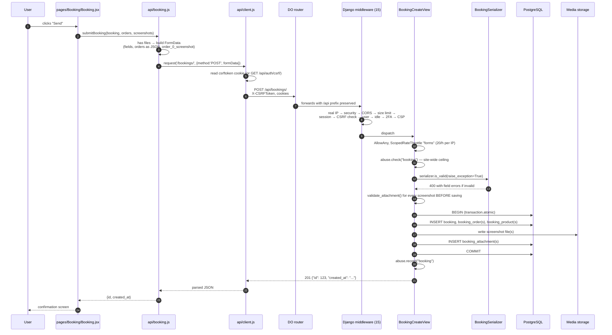

[VERIFIED: `frontend/src/api/booking.js::submitBooking`,
`backend/bookings/urls.py`, `backend/bookings/views.py::BookingCreateView.create`]

What each design choice buys:

| Choice in the code | Why |
|---|---|
| JSON when no files, multipart when files | Simple requests stay simple; booking + files saved together "or not at all" |
| All attachments validated **before** the transaction | A refused screenshot never leaves a half-stored booking |
| `transaction.atomic()` around all inserts | All rows or none |
| Signed-in user attached if present (`user = request.user if authenticated else None`) | The form works without an account, but links to one when possible |
| Only `{id, created_at}` returned | Nothing the sender did not already type is echoed |
| `abuse.record` only after success | Malformed floods can't use up the site-wide budget |

**Where it can fail and what the user sees** (detail → Vol 9):

| Failure point | HTTP | Frontend |
|---|---|---|
| Browser offline | — | `UNAVAILABLE` |
| Body too large / no `Content-Length` (`PublicRequestSizeLimitMiddleware`) | 413 / 411 | `UNAVAILABLE` |
| CSRF token missing/wrong | 403 | `UNAUTHENTICATED` → profile re-check |
| Throttle / site ceiling | 429 | `RATE_LIMITED` |
| Validation | 400 | field errors |
| DB down | 500 | `UNAVAILABLE`; `/api/ready/` → 503 |

---

## 11. How data moves through the system

### 11.1 Main data flows

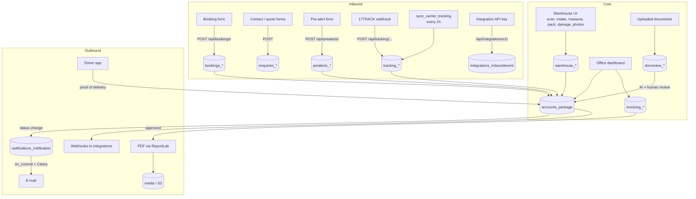

### 11.2 Files

All uploaded and generated files go through Django's storage API, so the same
code writes to local disk (`backend/media/…`) or to an S3-compatible bucket,
depending on `AWS_STORAGE_BUCKET_NAME`. Folders seen in development media:
`bookings/`, `documents/`, `invoices/`, `prealerts/`, `quotes/`,
`shop-logos/`.

- Files are **streamed through Django** with permission checks for private
  data (e.g. `attachment_response()` in `bookings/views.py`), not linked
  publicly.
- `DATA_UPLOAD_MAX_MEMORY_SIZE` 11 MB; files over 2 MB spool to disk.
- `PUBLIC_REQUEST_MAX_BYTES` (default 25 MB) caps public upload requests.

> ⚠️ On App Platform the container disk is **wiped at every deploy**. Without
> a bucket configured, uploads and invoice PDFs are lost. **[UNVERIFIED]**
> whether production has `AWS_STORAGE_BUCKET_NAME` set. → §16, Vol 8 §14.

### 11.3 E-mail and notifications

`notifications/services.py` creates a `Notification` row (shown in the bell
and on the profile) and then, in `transaction.on_commit`, queues
`send_notification_email.delay(pk)`. If queueing fails, the row still exists
and `emailed_at` stays `null` — the customer sees it in the app even if the
e-mail is lost. Triggers include `notify_invoice_sent`,
`notify_shipment_received`, `notify_shipment_status`.

---

## 12. How the application handles errors

### 12.1 Frontend layers

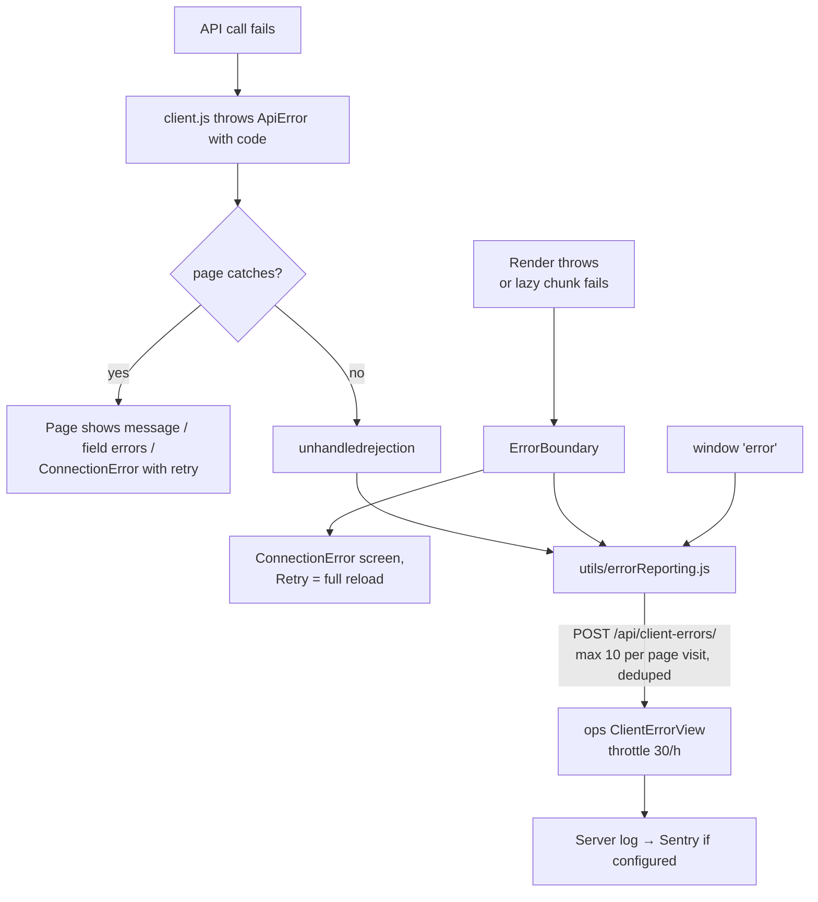

- `ErrorBoundary` (a class component — there is no hook equivalent) wraps the
  `<Suspense>` around all routes. Its main job is the **failed chunk
  download**: if the visitor lost connection mid-navigation, `lazy()` throws,
  and without the boundary the whole page would go white. Retry does a full
  reload because a failed module import is cached as failed.
- Chunk-load failures are **not** reported (they're the visitor's network,
  not a bug); other render errors are.
- `errorReporting.js` sends message, stack, page address and where it was
  caught — **never** who is signed in, cookies or form contents.

### 12.2 Backend layers

| Layer | Mechanism | Result |
|---|---|---|
| Serializer validation | `is_valid(raise_exception=True)` | 400 with `{field: [messages]}` |
| Permissions | DRF permission classes, `TwoFactorMiddleware` | 403 with `detail` (+ `code`) |
| Throttles | DRF throttles, `config/abuse.py` | 429 |
| Domain rules on models | `ShipmentLocked`, `InvalidShipmentTransition` | **409** via `accounts.errors.api_exception_handler` |
| Missing objects | `get_object_or_404`, `Http404` | 404 (also for a DB row whose file vanished) |
| Anything unhandled | Django | 500, logged; Sentry if `SENTRY_DSN`. `DEBUG=0` → no traceback to the browser |
| Background tasks | `CELERY_TASK_EAGER_PROPAGATES=False`, on_commit wrappers that log | Never turns a succeeded action into a 500 |

The 409 mapping is a good example of the project's philosophy (from the
docstring in `accounts/errors.py`): the rule is enforced in `Package.save()`
because "that is the only layer every write path goes through", and the
handler is global so "no view has to remember to catch them — including the
views nobody has written yet."

### 12.3 Startup and infrastructure errors

- `entrypoint.sh` runs `migrate` first and, if it fails, prints an explicit
  checklist (DATABASE_URL set? App in the DB's Trusted Sources?
  `DJANGO_DB_SSL_REQUIRE`?) instead of leaving the platform to report a vague
  "service unavailable".
- `DB_CONNECT_TIMEOUT=10` makes an unreachable database fail fast with a real
  error.
- `settings.py` refuses to boot in production without `DJANGO_SECRET_KEY` or a
  database.
- `/api/health/` (always 200 if Python is alive) vs `/api/ready/` (checks
  DB + cache; 503 if degraded). The App Platform health check is a **TCP**
  check, because its HTTP probe does not send the site's hostname and Django
  would answer 400 (`ALLOWED_HOSTS`).

Full troubleshooting procedures for each → Vol 9.

---

## 13. How the application handles user sessions

### 13.1 Session model

Server-side Django sessions (no `SESSION_ENGINE` override, so Django's
default database-backed store), identified by an `HttpOnly` cookie. Every new
sign-in also restarts two-factor verification (`accounts/staff_sessions.py`). [VERIFIED: settings lines 656–720, 791–833]

| Who | Lifetime | Mechanism |
|---|---|---|
| Customer | 14 days, **sliding** | `SESSION_COOKIE_AGE` + `SESSION_SAVE_EVERY_REQUEST=True` |
| Office staff and admins | ends after **60 min idle** (minimum 5) | `STAFF_SESSION_IDLE_MINUTES`; set on every sign-in by the `user_logged_in` signal handler in `accounts/staff_sessions.py`, enforced by the same `WarehouseIdleMiddleware` |
| Warehouse code/PIN session (shared device) | ends after **30 min idle**, counting only real actions | `WAREHOUSE_SESSION_IDLE_MINUTES`, `WarehouseIdleMiddleware` |
| Sensitive admin actions | password re-typed within **10 min** | `REAUTH_WINDOW_MINUTES`, `accounts/reauth.py` → `reauth_required` |
| Two-factor pending | can only reach an allow-list until the code is entered | `TwoFactorMiddleware` |
| Warehouse sign-in e-mail code | valid **15 min** | `WAREHOUSE_CODE_MINUTES` |
| Password reset link | **1 hour** | `PASSWORD_RESET_TIMEOUT` |

All are overridable by environment variables (names in Vol 3 §26).

### 13.2 Ways to sign in

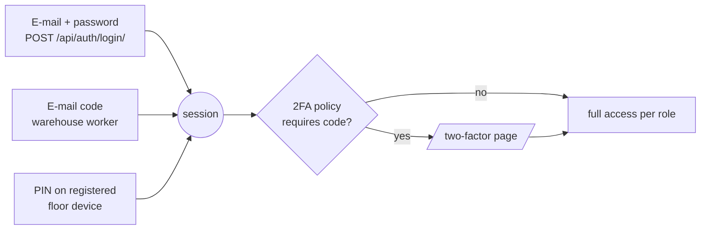

Login is rate-limited per IP (`login 10/hour`) **and** locked out per account
after `LOGIN_FAILURE_LIMIT` (10) failures for one account *from one address*,
or `LOGIN_FAILURE_ACCOUNT_LIMIT` (50) for one account *from all addresses
together*, within a 1-hour window (`accounts/lockout.py`). The per-address
counter means a stranger cannot lock a real user out. → Vol 6.

### 13.3 The idle clock, both sides

The warehouse idle timeout is enforced on the server and **mirrored** in the
browser so a shared tablet's screen also clears:

- Server: `WarehouseIdleMiddleware` stores the time of the last request *a
  person caused*; requests with `X-Background-Refresh: 1` are answered but not
  counted. Over the limit → `logout(request)`.
- Browser: `client.js` records `lastHeardFromServer()`; `AuthContext` checks
  every 5 s (and on `visibilitychange`) and, once the limit has passed, asks
  the server with a *background* profile read. If that fails → `user = null`
  → `RequireWarehouse` shows the sign-in screen.

---

## 14. How the major components depend on each other

### 14.1 Dependency graph

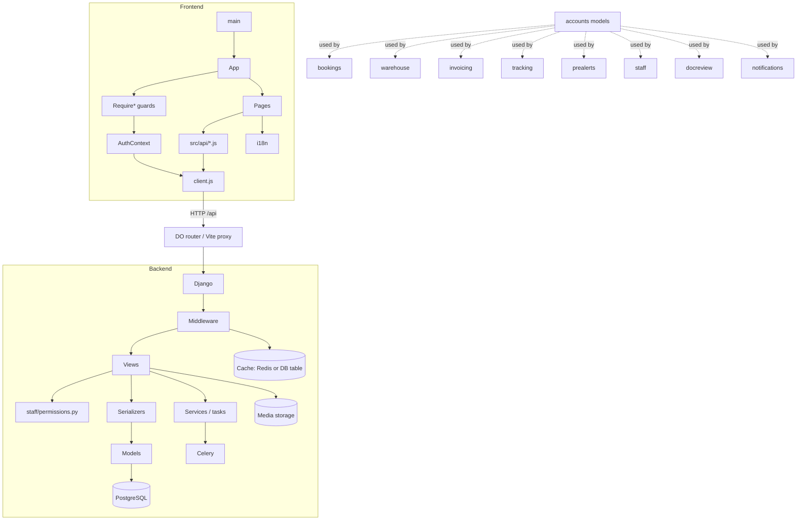

`accounts` is the hub: `User` and `Package` are referenced by nearly every
other app. `staff` has no models and reads/writes everyone else's.

### 14.2 What breaks when a component fails

| If this fails… | Then… | First check |
|---|---|---|
| DigitalOcean routes (`/api` without `preserve_path_prefix`) | Every API call gets HTML or 404; app shows "could not connect" everywhere | `smoke.yml`; `curl -s https://<site>/api/health/` 🟢 |
| `frontend` static site build | Site down or stale; API fine | App Platform build log |
| `api` service (gunicorn) | Public pages still load (static), every data call fails | `/api/health/` |
| PostgreSQL | `/api/health/` OK, `/api/ready/` 503; sign-in, booking, everything dynamic fails; container won't (re)start because `migrate` fails | `entrypoint.sh` output |
| Cache (DB table / Redis) | Throttles and lockouts can't count; `/api/ready/` 503 | `createcachetable` output |
| Media storage | Uploads/PDF downloads fail or 404 | bucket variables |
| SMTP | Sign-ups/resets/codes/notifications not delivered; in-app notification rows still created | e-mail settings, System page |
| OpenAI | Document review and chat unavailable; rest of site fine | `OPENAI_API_KEY` |
| 17TRACK / carriers | Courier tracking stale; rest fine | `TrackingSyncLog` |
| Celery broker set but no worker | Invoices/e-mails/webhooks queued **forever, silently** | Never set broker without a worker |
| `client.js` | Every page's data fails | browser console |
| `AuthContext` | Guards misbehave; everyone looks signed out | profile request in Network tab |
| `ErrorBoundary` absent | A failed chunk load = white screen | — |

Each row becomes a full procedure in → Vol 9 / Vol 10.

---

## 15. Production topology (summary)

| Component | Type | Source | Size | Notes |
|---|---|---|---|---|
| `frontend` | static_site | `frontend/`, `npm run build` → `dist` | CDN | `deploy_on_push` from `main`; catch-all `index.html` |
| `api` | service | `backend/Dockerfile` (Python 3.12-slim, non-root uid 10001, pg_dump 18 client) | 1 × `apps-s-1vcpu-1gb` | `WEB_CONCURRENCY=2` gunicorn workers, timeout 60 s, TCP health check |
| `db` | managed PG 17 | — | dev tier (`production: false`) | `${db.DATABASE_URL}` |
| `worker` | worker | same image, `celery -A config worker` | — | **commented out** |
| jobs ×3 | scheduled | same image | 0.5 GB | **commented out** |

Environment values in the committed spec (non-secret): `DJANGO_DEBUG=0`,
`DJANGO_ALLOWED_HOSTS=${APP_DOMAIN}`, `DJANGO_FRONTEND_URL=${APP_URL}`,
`DJANGO_CLIENT_IP_HEADER=Do-Connecting-Ip`, `DJANGO_NUM_PROXIES=1`,
`DJANGO_HSTS_SECONDS=300`, `WEB_CONCURRENCY=2`. Secrets are added in the
dashboard as encrypted variables (names only, listed in the spec):
`DJANGO_SECRET_KEY`, `DJANGO_TWO_FACTOR_ENCRYPTION_KEYS`, e-mail, bucket,
`OPENAI_API_KEY`, `SEVENTEEN_TRACK_API_KEY`, `SENTRY_DSN`.

Full deployment procedure → Vol 8.

---

## 16. Architecture risks and open questions

Found while writing this volume. Each is a fact from the repository (or the
absence of one), with a recommended action. Owners should confirm and tick
them off; Vol 10 keeps the live register.

| # | Severity | Finding | Evidence | Recommended action |
|---|---|---|---|---|
| R1 | **High** | Nightly database backup job is commented out in the App Spec. Unless enabled in the dashboard, no application-level backups run. | `.do/app.yaml` `jobs:` block commented | Confirm in dashboard. Enable `database-backup` job with a bucket; test a restore (Vol 10). |
| R2 | **High** | Uploads/PDFs are lost on every deploy unless an S3-compatible bucket is configured. | Spec comment on `AWS_*`; `MEDIA_ROOT` on container disk | Confirm `AWS_STORAGE_BUCKET_NAME` is set in production. |
| R3 | **Medium** | Production database is declared `production: false` (DigitalOcean dev database tier). | `.do/app.yaml` `databases` | Review the tier's backup/availability guarantees vs. business needs; consider a production cluster. |
| R4 | Medium | Courier tracking sync and daily reports jobs are also commented out. | `.do/app.yaml` | Confirm whether tracking relies on 17TRACK webhooks only. |
| R5 | Medium | Tests run on SQLite; production on PostgreSQL. | `ci.yml` env comment | Add a Postgres service to CI, at least nightly (Vol 7). |
| R6 | Medium | Tests write into the real `backend/media/` (hundreds of 67-byte `shop-logos/logo_*.png`). No test-time `MEDIA_ROOT` override found. | `backend/media/shop-logos/`; `grep MEDIA_ROOT` | Set a temporary `MEDIA_ROOT` when `TESTING` (Vol 7). |
| R7 | Low | HSTS is 300 s — intentionally short for first deploy. | `.do/app.yaml` | Raise to 31536000 once the final domain is confirmed working over HTTPS. |
| R8 | Low | ~262 files of a root `node_modules/` are tracked in git; neither app uses it. | root `.gitignore` comment | `git rm -r --cached node_modules` 🟠 (removes from git index only, not disk). |
| R9 | Info | Settings comments describe Railway, Neon, Supabase; `.gitignore` mentions Vercel. Production is DigitalOcean. | `settings.py`, `.gitignore` | Treat as portability notes, not current infrastructure. |
| R10 | Info | Real secrets exist on the developer machine in `backend/.env` and `.do/local/` (both git-ignored). | `.gitignore`, `backend/.gitignore` | Verify they were never committed: `git log --all -- .do/local backend/.env` 🟢. Rotate anything that was. |
| R11 | Info | Footer links to `/about-us` and `/cookies`, which do not exist (show 404). | `docs/WEBSITE-MAP.md` §8 | Add pages or remove links. |

**[UNVERIFIED] — needs the owner or dashboard access:** which optional
services are live (Spaces bucket, Redis, Sentry, SMTP provider, OpenAI,
17TRACK); the domain registrar and DNS provider; whether a custom domain is
attached; who has dashboard and GitHub admin access.

---

## 17. Glossary (part 1)

| Term | Meaning in this project |
|---|---|
| **App (Django)** | A feature folder in `backend/` with its own models/views/urls (e.g. `bookings`). |
| **App (DigitalOcean)** | The whole deployment unit `plsm`, containing components `frontend`, `api`, `db`. |
| **App Spec** | `.do/app.yaml`, the declarative description of the DigitalOcean App. |
| **ApiError** | The error class thrown by `src/api/client.js`, carrying `code`, `fields`, `status`. |
| **Booking (boekingsbon)** | The customer's form saying parcels are coming, with one order row per webshop. |
| **Catch-all document** | `index.html` served for any path without its own file, so React's router can handle it. |
| **Celery eager mode** | Tasks executed inline when no broker is configured. |
| **CSRF** | Cross-Site Request Forgery. Django requires the `X-CSRFToken` header on writes. |
| **Floor device** | A shared warehouse tablet registered by an admin; workers sign in on it with a PIN. |
| **Guard** | A React wrapper (`RequireAuth`, `RequireStaff`, …) that redirects; UX only, not security. |
| **Intake sheet** | Warehouse record of parcels received, with measurements. |
| **Lazy chunk** | A page's JavaScript split into its own file, downloaded on first visit. |
| **Package** | A customer's shipment (`accounts.Package`), the central business object. |
| **Pre-alert** | A customer registering a courier parcel that is on its way to the warehouse. |
| **Prerender** | Writing real HTML for public routes at build time (SEO). |
| **Re-auth** | Typing the password again for a sensitive action within 10 minutes. |
| **Same-origin deployment** | Site and API on one domain via path routing, so cookies are first-party. |
| **Session authentication** | Identity carried by Django's `sessionid` cookie; the only auth for people. |
| **Shipment lock** | Model-level rule refusing changes to a shipment past a certain stage (→ 409). |
| **Throttle scope** | A named rate-limit budget (e.g. `forms` = 20/hour). |
| **Warehouse stage** | Floor progress field on a package, separate from the commercial `status`. |
| **17TRACK** | Third-party parcel-tracking aggregator used for courier numbers. |

---

## 18. Source files this volume depends on

If any of these change, re-check the sections in brackets.

- `frontend/package.json` [§3.1] · `frontend/vite.config.js` [§5.7, §9.1] ·
  `frontend/src/main.jsx` [§5.1] · `frontend/src/App.jsx` [§5.2] ·
  `frontend/src/api/client.js` [§9.3] · `frontend/src/api/booking.js` [§10] ·
  `frontend/src/auth/AuthContext.jsx` [§9.4, §13.3] ·
  `frontend/src/components/ErrorBoundary/ErrorBoundary.jsx` [§12.1] ·
  `frontend/src/utils/errorReporting.js` [§12.1]
- `backend/requirements*.txt` [§3.2] · `backend/config/settings.py`
  [§3.3, §6.4, §6.5, §7.1, §13] · `backend/config/urls.py` [§8.1] ·
  `backend/config/health.py` [§12.3] · `backend/config/celery.py` [§6.6] ·
  `backend/accounts/models.py` [§1.1, §1.2, §7] ·
  `backend/accounts/middleware.py` [§13] · `backend/accounts/errors.py`
  [§12.2] · `backend/staff/permissions.py` [§6.4] ·
  `backend/bookings/views.py`, `urls.py` [§10] ·
  `backend/notifications/services.py` [§11.3] · all `*/models.py` [§6.2, §7.2]
- `backend/Dockerfile`, `backend/entrypoint.sh` [§12.3, §15] ·
  `.do/app.yaml` [§2, §15, §16] · `.github/workflows/*.yml` [§3.4]
- `docs/WEBSITE-MAP.md` [§1, §5.2]

**Next:** Volume 2 — React.js, taught through this codebase.
